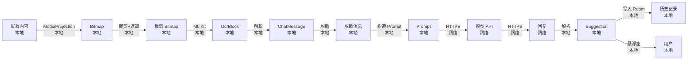

# 隐私与安全

> ChatAssist 的数据流审计、敏感信息处理、用户告知、隐私政策核心要点。
> 唯一原则：**用户数据不离开用户设备**（除用户自配的模型 API）。

---

## 1. 数据流审计

**唯一网络出口**：用户配置的模型 API URL。
OkHttp `WhitelistInterceptor` 强制白名单，**禁止任何其他域名请求**。

## 2. 敏感信息处理

| 项 | 处理 | 实现 |
|---|------|------|
| API Key | EncryptedSharedPreferences + Android Keystore | `ConfigRepository` |
| 历史记录中 API Key | 永不出现 | Room schema 设计层 |
| Release 日志 | API Key / 对方昵称 / 消息内容全部脱敏 | `Logger` 工具类 |
| 截图内存 | 用完立即清零 | `Bitmap.recycle()` + 引用置空 |
| 隐私模式开关 | 开启后不写历史、不缓存截图 | `ConfigRepository.privacyMode` |
| Release 包 verbose 日志 | 关闭 | `BuildConfig.DEBUG` 判定 |

## 3. 权限申请合规

| 权限 | 申请时机 | 申请话术 | 拒绝后引导 |
|------|----------|----------|------------|
| 通知（Android 13+） | 首次启动 | 用于在后台通知你识别结果 | 引导开启系统通知 |
| 悬浮窗 | 首次使用触发球 | 用于在其他 App 上显示建议回复 | 引导开启悬浮窗 |
| MediaProjection | 每次触发识别 | 用于截取当前聊天界面 | 引导重新授权 |
| 前台服务 | 触发识别时 | 截图服务需要常驻通知 | 引导开启后台运行 |

## 4. 隐私政策核心要点

1. **读取屏幕内容仅用于生成回复建议，不存储原文**
   - 截图识别后立即清零内存
   - 历史记录只保存解析后的结构化数据（不存截图）
2. **聊天内容在发送给模型前会脱敏**
   - 自动检测并替换手机号、身份证、邮箱等敏感信息
3. **大模型由用户自行选择**
   - 数据流向取决于用户配置的 provider
   - 我们不收集任何模型 API Key 或响应内容
4. **不收集设备标识、不上传用户行为数据**
   - 无统计 SDK、无广告 SDK、无分析 SDK
5. **用户可随时关闭并清除所有数据**
   - 设置 → 隐私 → 一键清空所有历史
   - 卸载 App 立即清除所有本地数据

## 5. 隐私政策页 UI 要求

- 首次启动必须展示
- 用户必须**勾选同意**才能进入 App
- 不同意时显示「未同意隐私政策，无法使用」+ 退出按钮
- 政策文本必须可滚动、可复制
- 政策版本号在「关于」页可查

## 6. 第三方依赖审计

| 依赖 | 数据采集 | 风险等级 | 处置 |
|------|----------|----------|------|
| Google ML Kit (bundled) | 无 | 低 | bundled 离线模型，无网络请求 |
| Hilt / Dagger | 无 | 低 | 编译期依赖 |
| Room | 无 | 低 | 本地数据库 |
| Retrofit / OkHttp | 无 | 低 | 仅用户配置的 API |
| Compose | 无 | 低 | 纯 UI 框架 |
| 任何统计 / 广告 SDK | — | **禁止引入** | 见技术栈禁止清单 |

## 7. 安全更新

- 依赖升级时审计 CVE（GitHub Dependabot 自动化）
- 重大安全更新 24h 内发布
- Release 包经过 ProGuard / R8 混淆

## 8. 状态追踪

- [x] v0.1 — 数据流图与策略定义
- [ ] v0.3 — EncryptedSharedPreferences 集成
- [ ] v0.5 — 脱敏工具实现
- [ ] v0.7 — 隐私政策页 UI
- [ ] v1.0 — 第三方依赖审计清单
